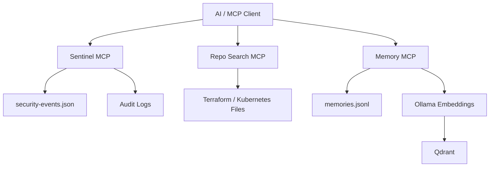

#  Lemon SecOps MCP

Lemon SecOps is a modular **Model Context Protocol (MCP)** project that demonstrates how multiple MCP servers can work together in an AI-assisted security and DevOps investigation workflow.

The project currently includes:

- **Sentinel MCP** — retrieves and searches security incidents
- **Repo Search MCP** — safely inspects infrastructure and source-code files
- **Memory MCP** — stores and retrieves persistent semantic memory using Qdrant and Ollama

The main goal is to understand how MCP servers, tools, schemas, memory, security controls, and external integrations fit together in a real multi-server architecture.

---

## Architecture



Each MCP server has a separate responsibility, making the platform easier to develop, test, secure, and extend.

---

## Project Structure

```text
lemon-secops/
├── README.md
├── .env.example
├── .mcp.json.example
├── docker-compose.yml
├── install.sh
├── setup.sh
├── data/
│   ├── security-events.json
│   └── memory/
├── logs/
├── sample-repository/
│   ├── terraform/
│   └── kubernetes/
└── servers/
    ├── memory-mcp/
    ├── repo-search-mcp/
    └── sentinel-mcp/
```

---

## Sentinel MCP

The Sentinel MCP simulates a security platform such as Microsoft Sentinel.

Current backend:

```text
data/security-events.json
```

Available tools:

```text
list_incidents
get_incident
search_incidents
```

Example tool call:

```json
{
  "id": "INC001"
}
```

Flow:

```text
MCP Client
   ↓
get_incident
   ↓
Sentinel MCP
   ↓
events.ts
   ↓
security-events.json
```

The current JSON backend can later be replaced with the real Microsoft Sentinel API while keeping the same MCP tool interface.

---

## Repo Search MCP

The Repo Search MCP allows controlled inspection of infrastructure and source-code files.

Example repository:

```text
sample-repository/
├── terraform/
└── kubernetes/
```

Typical capabilities:

```text
list_files
read_file
search_repo
```

A key feature is safe path validation.

Allowed:

```text
terraform/main.tf
```

Blocked:

```text
../../../../etc/passwd
```

This prevents directory traversal and keeps the MCP server limited to the approved repository.

---

## Memory MCP

The Memory MCP provides persistent and semantic memory.

It uses:

```text
JSONL
+
Qdrant
```

for different purposes:

```text
JSONL
→ durable memory storage

Qdrant
→ semantic search
```

Memory flow:

```text
New Memory
   |
   +------> memories.jsonl
   |
   +------> Ollama
                |
                v
          nomic-embed-text
                |
                v
             Qdrant
```

Example tools:

```text
remember
search_memory
list_memories
```

A stored memory such as:

```text
ECS deployment failed because the target group health-check port was incorrect.
```

can later be retrieved with a differently worded query such as:

```text
What was the load balancer issue?
```

---

## Qdrant and Ollama

### Qdrant

Qdrant is the vector database used for semantic memory search.

Start it with:

```bash
docker compose up -d
```

Dashboard:

```text
http://localhost:6333/dashboard
```

### Ollama

Ollama runs the embedding model locally.

Current model:

```text
nomic-embed-text
```

Flow:

```text
Text
 ↓
Ollama
 ↓
Embedding Vector
 ↓
Qdrant
```

This allows local development without requiring a paid embedding API.

---

## MCP Configuration

Lemon uses `.mcp.json` to register multiple MCP servers.

Example:

```json
{
  "mcpServers": {
    "memory": {
      "command": "bun",
      "args": [
        "/ABSOLUTE/PATH/lemon-secops/servers/memory-mcp/src/index.ts"
      ]
    },
    "repo-search": {
      "command": "bun",
      "args": [
        "/ABSOLUTE/PATH/lemon-secops/servers/repo-search-mcp/src/index.ts"
      ]
    },
    "sentinel": {
      "command": "bun",
      "args": [
        "/ABSOLUTE/PATH/lemon-secops/servers/sentinel-mcp/src/index.ts"
      ]
    }
  }
}
```

This tells an MCP-capable client how to launch each server.

---

## Example Investigation Flow

```text
User:
Investigate incident INC001

        ↓

Sentinel MCP
get_incident("INC001")

        ↓

Repo Search MCP
inspect relevant infrastructure files

        ↓

Memory MCP
search previous related findings

        ↓

Memory MCP
store the new investigation result
```

This demonstrates how multiple MCP servers can participate in one workflow.

---

## Audit Logging

Lemon stores MCP tool activity in:

```text
logs/tool-calls.jsonl
```

Example:

```json
{
  "timestamp": "2026-10-13T19:48:00.316Z",
  "server": "sentinel",
  "tool": "get_incident",
  "success": true,
  "details": {
    "id": "INC001"
  }
}
```

This provides basic observability, debugging, and traceability.

---

## Testing

MCP servers can be tested with MCP Inspector.

Example:

```bash
cd servers/sentinel-mcp
bunx @modelcontextprotocol/inspector bun src/index.ts
```

Expected tools:

```text
list_incidents
get_incident
search_incidents
```

Automated tests can be run with:

```bash
bun test
```

---

## Technology Stack

| Technology | Purpose |
|---|---|
| TypeScript | MCP server development |
| Bun | Runtime and package manager |
| MCP SDK | MCP server implementation |
| Zod | Tool input validation |
| Qdrant | Vector database |
| Ollama | Local AI runtime |
| nomic-embed-text | Embeddings |
| JSONL | Memory and audit storage |
| Docker | Qdrant runtime |
| Git / GitHub | Version control |
| MCP Inspector | MCP testing |

---

## Security Concepts Demonstrated

Lemon includes:

- MCP input validation
- safe filesystem boundaries
- directory traversal prevention
- local secret isolation
- modular server separation
- audit logging
- least-privilege design
- replaceable backend adapters

Sensitive and machine-specific files are excluded from Git, including:

```text
.env
.mcp.json
node_modules/
logs/*.jsonl
data/memory/*.jsonl
```

---

## Current Status

```text
Multi-server MCP architecture     ✅
Sentinel MCP                      ✅
Repo Search MCP                   ✅
Memory MCP                        ✅
Qdrant                            ✅
Ollama embeddings                 ✅
Safe path validation              ✅
MCP configuration                 ✅
Audit logging                     ✅
Basic automated tests             ✅
GitHub repository                 ✅
```

---

## Future Roadmap

Planned improvements:

```text
Real Microsoft Sentinel API
Microsoft Defender MCP
Microsoft Entra MCP
AWS MCP
GitHub MCP
Kubernetes MCP
Hybrid Memory Recall
Authentication / Authorization
Improved Observability
Production Deployment
```

---

## Long-Term Vision

The long-term goal of Lemon is to evolve into a modular **AI-powered SecOps and DevOps investigation platform**.

Instead of manually checking multiple systems, an AI client could use MCP tools to gather information from:

```text
Security Incident
      ↓
Sentinel MCP
      ↓
Identity Context
      ↓
Entra MCP
      ↓
Cloud Infrastructure
      ↓
AWS MCP
      ↓
Repository Data
      ↓
Repo Search MCP
      ↓
Previous Findings
      ↓
Memory MCP
```

The aim is to provide controlled, auditable, and modular AI access to security and infrastructure systems through MCP.

---

## Summary

Lemon SecOps combines:

```text
MCP
+
Security Incidents
+
Repository Inspection
+
Persistent Memory
+
Qdrant
+
Ollama
+
Security Controls
+
Audit Logging
```

It serves as a practical foundation for understanding how larger MCP-based AI security platforms can be designed and extended.
